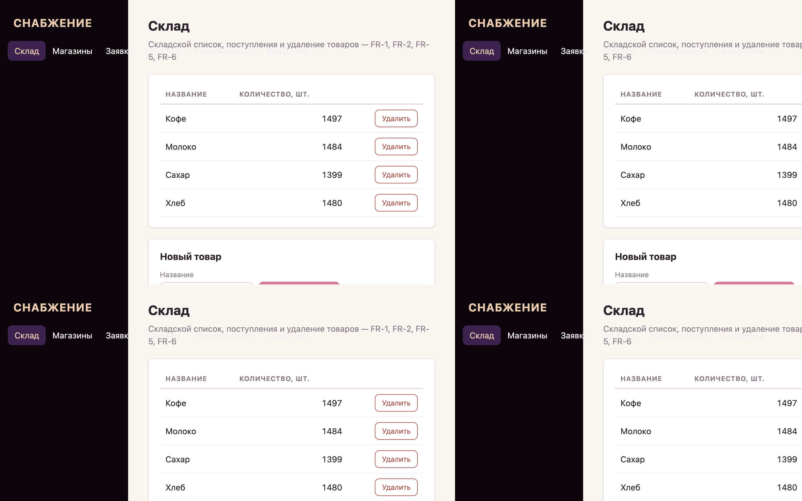
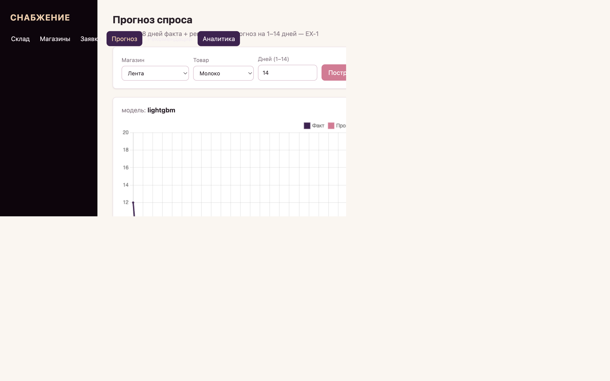
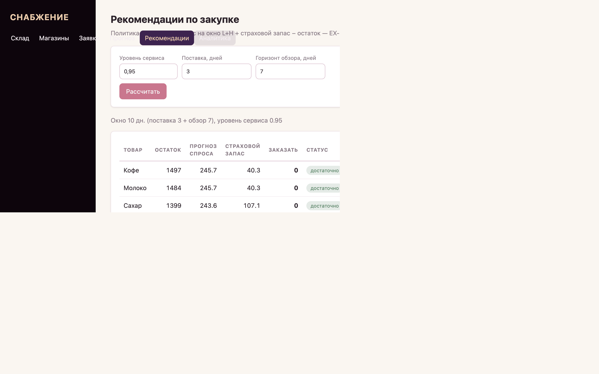
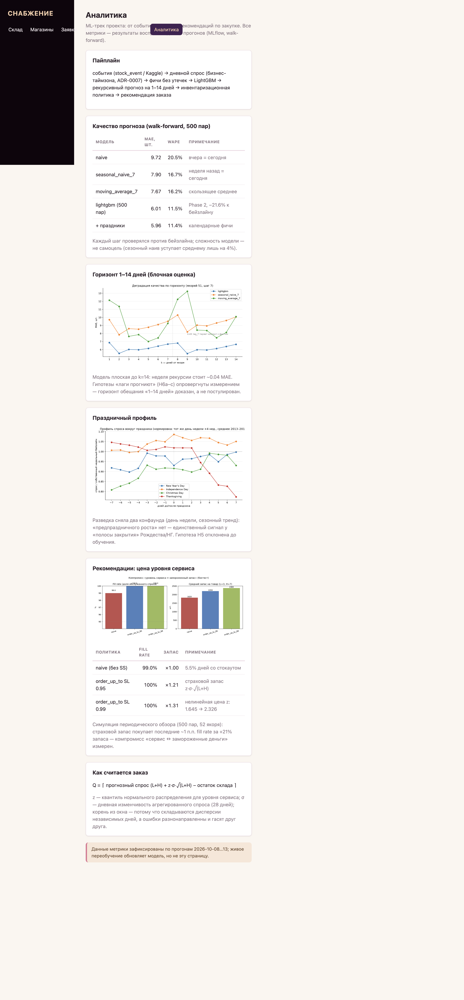

# Inventory Intelligence Platform

Information system for the supply department of a wholesale warehouse — a portfolio
project built on top of an educational assignment (СПбГЭТУ «Технология
программирования», Тема 4), extended into an end-to-end ML-engineering system.

- Requirements: `docs/requirements.md` (Phase 0 — complete)
- Architecture: `docs/architecture.md`, ADRs in `docs/decisions/`
- Database design: `docs/database.md`
- Progress log: `docs/project-status.md`

## What's inside

- **Backend**: FastAPI + SQLAlchemy + PostgreSQL, 11 operations (FR-1…FR-11)
  through three doors: API, CLI menu, tests — domain-first packages, ADR-driven;
- **Event history**: append-only `stock_event` journal (ADR-0006) — ground truth
  for the ML track;
- **Web UI** (EX-3): React + TypeScript SPA — all 11 operations, forecast chart,
  replenishment table, ML analytics; thin client over the same API (ADR-0008),
  single origin — FastAPI serves the built bundle (ADR-0009).
- **ML track**: demand dataset over events/Kaggle CSV → baselines → LightGBM:

```text
model                  MAE    WAPE        (kaggle/store-item-demand, walk-forward)
naive                  9.72   20.5%
seasonal_naive_7       7.90   16.7%
moving_average_7       7.67   16.2%
lightgbm (50 pairs)    5.79   12.2%
lightgbm (FULL 500)    6.01   11.5%      ← beats the baseline by 21.6% MAE
+holiday features      5.96   11.4%      ← injectable country calendar
```

The 1–14 day horizon is **measured, not promised** (blocked evaluation:
model stays flat to k=14 — MAE 5.5–6.9, week of recursion costs ~0.04;
baselines decay — see `docs/img/horizon_degradation.png`).

- **Replenishment** (EX-2): order-up-to policy over forecasts —
  `GET /api/recommendations` + CLI 13. The forecast becomes a purchasing
  decision: Q = forecast + z·σ·√(L+H) − stock. Policy backtest (500 pairs,
  weekly review, L=3): fill rate 99.0% (no safety stock) → 100% (SL 0.95,
  stock ×1.21) → 100% (SL 0.99, ×1.31) — the price of service level is
  measured, not assumed (`docs/img/replenishment_policies.png`).

Every experiment is tracked in MLflow (`mlflow ui`), features are leak-safe by
construction (see `app/ml/features.py`), hypotheses are grounded in
`docs/img/` exploration charts.

## Web UI

Six screens (dark sidebar №4745): склад (FR-1/2/5/6), магазины + товары по
магазинам (FR-3/4/7/11), заявки (FR-8/9/10), прогноз, рекомендации, аналитика.

| Склад — список, поступление | Прогноз — факт + рекурсивный горизонт |
|---|---|
|  |  |

| Рекомендации — order-up-to | Аналитика — метрики и методология |
|---|---|
|  |  |

Also: [магазины](docs/img/ui-stores.png), [заявки](docs/img/ui-requests.png).

## Quick start

```bash
# 1. PostgreSQL (Docker)
docker compose up -d db

# 2. Python environment
python3 -m venv .venv
.venv/bin/pip install -e ".[dev]"

# 3. Migrations
.venv/bin/alembic upgrade head

# 4. Run the API
.venv/bin/uvicorn app.main:app --reload
```

API docs: http://127.0.0.1:8000/docs — the API also serves the last built SPA
(`frontend/dist`, if present) at the root.

Frontend dev mode (hot reload, `/api` proxied to the API — one origin, no CORS):

```bash
cd frontend
npm ci
npm run dev   # http://127.0.0.1:5173
```

## Tests

```bash
docker compose up -d db   # integration/API tests need PostgreSQL
.venv/bin/pytest           # backend: unit + integration + API
cd frontend && npm test    # frontend: vitest
```

## Demo

Full assignment scenario (FR-1 … FR-11) against a running API:

```bash
.venv/bin/uvicorn app.main:app --port 8000   # terminal 1
scripts/demo.sh                               # terminal 2
```

## Interactive menu (CLI)

The system can also be used interactively — the same services behind the third door:

```bash
.venv/bin/python -m app.cli
```

All 11 operations in Russian, human-readable domain errors (BR-rules referenced
in messages), exit with `0`.

## Full stack (Docker)

```bash
docker compose up --build -d    # postgres + api (migrations, /api, SPA, /img)
```

One multi-stage image (ADR-0009): a Node stage builds the SPA, the Python stage
ships the API with the built bundle — no Node in the runtime image. UI:
http://127.0.0.1:8000
