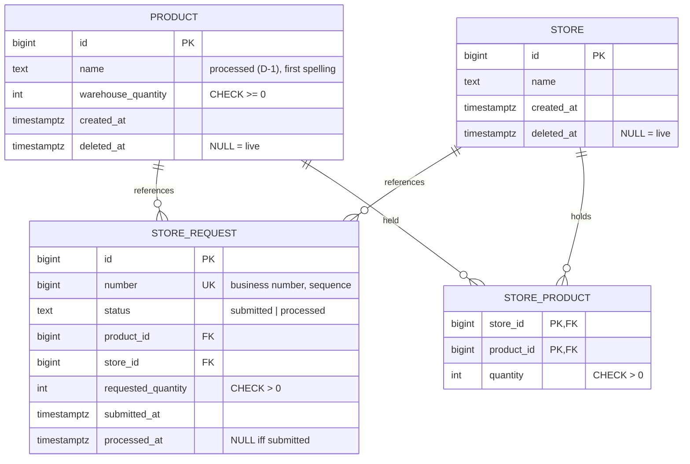

# Database design

> Phase 1 — design. Grounded in `docs/requirements.md` (Phase 0) and ADR-0004/0005.
> PostgreSQL 16. All schema changes via Alembic — never applied manually.

## 1. ER overview

## 2. Tables

### product (товар)

| Column | Type | Constraints |
|---|---|---|
| id | BIGINT | PK, `GENERATED ALWAYS AS IDENTITY` |
| name | TEXT | NOT NULL; processed per D-1; stored spelling = first entered (EL-4) |
| warehouse_quantity | INTEGER | NOT NULL, `CHECK (warehouse_quantity >= 0)` — 0 allowed (FR-1), negative never |
| created_at | TIMESTAMPTZ | NOT NULL, DEFAULT now() |
| deleted_at | TIMESTAMPTZ | NULL = live (soft delete, ADR-0005) |

Index: `UNIQUE INDEX product_live_name_key ON product (lower(name)) WHERE deleted_at IS NULL`
(BR-2 among live rows only — ADR-0004 + soft delete).

### store (магазин)

Same shape as product: id PK, name NOT NULL, created_at, deleted_at.
Index: `UNIQUE INDEX store_live_name_key ON store (lower(name)) WHERE deleted_at IS NULL` (BR-4).

### store_request (заявка)

| Column | Type | Constraints |
|---|---|---|
| id | BIGINT | PK identity (surrogate) |
| number | BIGINT | NOT NULL UNIQUE, `DEFAULT nextval('store_request_number_seq')` — business number (EL-14: uniqueness without continuity → a plain sequence fits; Postgres allows only **one** identity column per table, hence an explicit sequence) |
| status | TEXT | NOT NULL, `CHECK (status IN ('submitted','processed'))` — English codes in DB, «подана»/«обработана» mapped at the API edge; TEXT+CHECK chosen over a native ENUM for cheaper migration |
| product_id | BIGINT | NOT NULL FK → product(id) (plain, RESTRICT default) |
| store_id | BIGINT | NOT NULL FK → store(id) |
| requested_quantity | INTEGER | NOT NULL, `CHECK (requested_quantity > 0)` (BR-6) |
| submitted_at | TIMESTAMPTZ | NOT NULL DEFAULT now() (A-3; «текущий год» = year of this timestamp) |
| processed_at | TIMESTAMPTZ | NULL; cross-column invariant (EL-15): `CHECK ((status = 'submitted' AND processed_at IS NULL) OR (status = 'processed' AND processed_at IS NOT NULL))` |

Indexes: UNIQUE(number) — FR-9 lookup + FR-10 ordering;
partial `INDEX store_request_pending_store ON store_request (store_id) WHERE status = 'submitted'`
— serves the BR-8 guard. No product_id index yet: no current query needs it
(add when a query pattern demands it — and measure).

### store_product (количество товара в магазине)

| Column | Type | Constraints |
|---|---|---|
| store_id | BIGINT | PK part, FK → store(id) |
| product_id | BIGINT | PK part, FK → product(id) |
| quantity | INTEGER | NOT NULL, `CHECK (quantity > 0)` (FR-7 note: no operation ever decreases it; a zero row cannot exist — absence = no stock) |

Composite PK (store_id, product_id): uniqueness + the FR-7 read pattern (grouped by
store) is served by the PK's leading column. Row born on first shipment (FR-9).

## 3. Policies

- **Soft delete everywhere** (ADR-0005): physical DELETE is never issued by the app;
  FK options (`ON DELETE …`) are therefore unused by design.
- **The two soft-delete taxes** (must not be forgotten):
  1. every list read filters `deleted_at IS NULL` (FR-6, FR-7, and store lists);
  2. uniqueness is enforced by **partial** indexes over live rows only — a soft-deleted
     «МОЛОКО» does not block re-adding the name.
- **CHECK constraints as the last line of defense**: BR-5/BR-6 (positive quantities),
  warehouse ≥ 0, store_product > 0, the status/date invariant. The service layer still
  checks first (friendly deterministic errors, EL-3) — the DB guarantees under concurrency
  (same pattern as ADR-0004).
- **Timestamps**: created_at (audit), submitted_at/processed_at (A-3 + future ML history).
  TIMESTAMPTZ chosen over DATE to keep time-of-day for the ML extension at zero cost.
- **Naming**: snake_case, English identifiers; Russian domain terms live at the API edge.

## 4. Migration plan (Alembic, per vertical slice)

| Migration | Content | Slice |
|---|---|---|
| 0001 | product table + live-name unique index | 1 (products) |
| 0002 | store table + index | 2 (stores) |
| 0003 | store_request + sequence + indexes; store_product | 3 (requests) |
| 0004 | (none — FR-7 reads existing tables) | 4 (per-store view) |

Slice-sized migrations keep each vertical slice self-contained and revertable.

## 5. Open design notes

- OP-3 (spawned by this design review, see `docs/requirements.md` Section 9): BR-3 checks
  warehouse quantity only; store_product rows may still hold a soft-deleted product.
  FR-7 semantics for such rows depend on the OP-3 resolution.
- Current-quantity columns (warehouse_quantity) represent *state*; the receipt/shipment
  *event history* (ML gold) is a deliberate future extension — an event-log table fed by
  FR-5/FR-9, not a replacement for state columns.
